<a href="https://efeberkayalan.com"></a>

  <a href="https://efeberkayalan.com">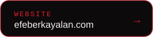</a>
  <a href="https://www.linkedin.com/in/efeberkayalan/">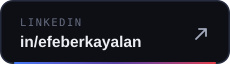</a>
  <a href="mailto:info@efeberkayalan.com">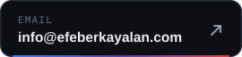</a>

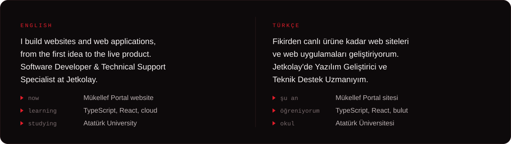


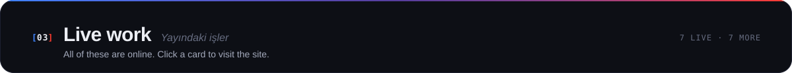

  <a href="https://klinikonam.com">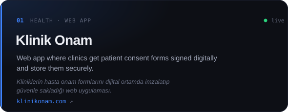</a>
  <a href="https://mukellefportal.com">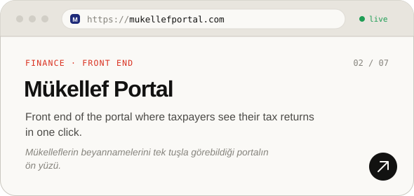</a>
  <a href="https://samsuneimzaofisi.com"></a>
  <a href="https://jetkolay.com">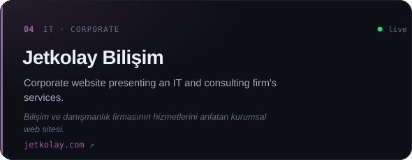</a>
  <a href="https://busumuhendislik.com">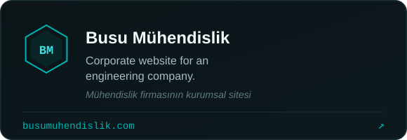</a>
  <a href="https://www.hizirgundogdu.com.tr">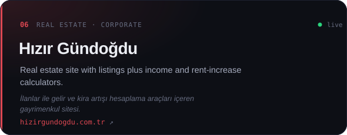</a>
  <a href="https://mazotcum.com.tr">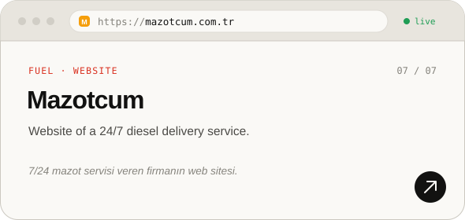</a>
  <a href="https://efeberkayalan.com">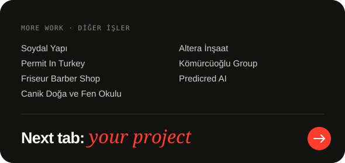</a>

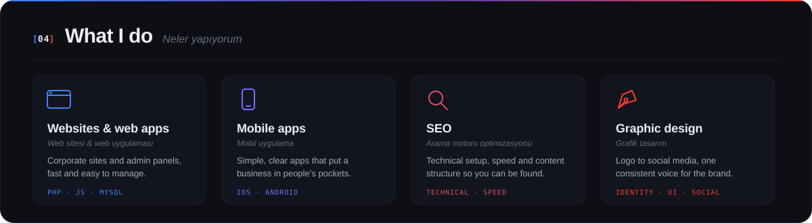

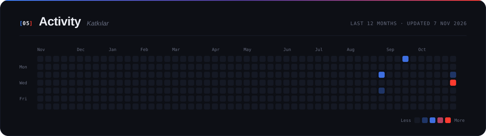

<a href="mailto:info@efeberkayalan.com"></a>
